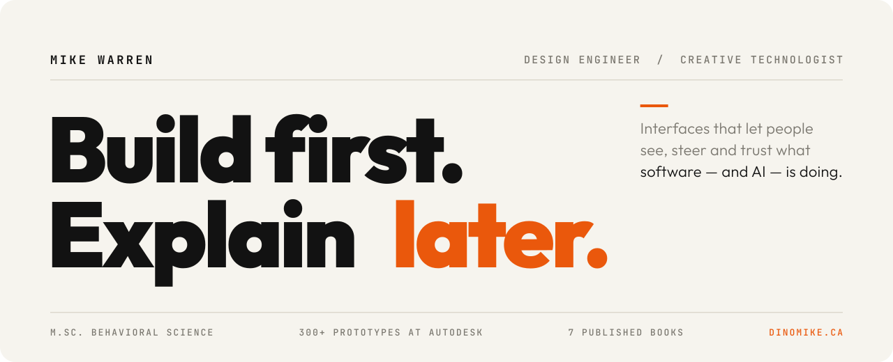

 

<table>
<tr>
<td colspan="2" valign="top">

00 &nbsp;·&nbsp; THE PORTFOLIO
### [The Maker Compound ↗](https://dinomike.ca)
My work as an explorable 3D world. Walk into a workshop, open a project, follow the avatar. Prefer it flat? There's a [classic version](https://dinomike.ca/classic.html).

<kbd>Web</kbd> <kbd>Three.js</kbd> <kbd>WebGL</kbd>

</td>
</tr>
<tr>
<td width="50%" valign="top">

01
### [IdeaBox ↗](https://dinomike.ca/IdeaBox/)
Describe a part in plain language. An LLM reads the intent; deterministic TypeScript turns it into fabrication-ready SVG you can inspect and edit.

<kbd>Web</kbd> <kbd>AI → SVG</kbd> <kbd>TypeScript</kbd>

</td>
<td width="50%" valign="top">

02
### [TimberCraft Studio ↗](https://dinomike.ca/TimberCraft/)
Roof framing in a live 3D viewport: code-compliance checks, ghost comparisons and one-click fixes instead of a chat box.

<kbd>Web</kbd> <kbd>3D</kbd> <kbd>Three.js</kbd>

</td>
</tr>
<tr>
<td width="50%" valign="top">

03
### [ShelfLife ↗](https://dinomike.ca/NoteToShelf/)
A reading archive that turns your books into a personal 3D shelf and shareable, collectible artifacts.

<kbd>Web</kbd> <kbd>React</kbd> <kbd>Analytics</kbd>

</td>
<td width="50%" valign="top">

04
### [AR Workspace Organizer ↗](https://dinomike.ca/GarageStudio/)
Projected labels and cut lists that stay legible against the visual noise of a real garage.

<kbd>📱 Phone app</kbd> <kbd>AR</kbd>

</td>
</tr>
<tr>
<td width="50%" valign="top">

05
### [Toybox Siege ↗](https://dinomike.ca/ToyboxSiege/)
Mixed-reality tabletop physics: build a siege engine and fire it across your living room.

<kbd>📱 Phone app</kbd> <kbd>AR</kbd> <kbd>Physics</kbd>

</td>
<td width="50%" valign="top">

06
### [Solar ROI ↗](https://dinomike.ca/solar.html)
Utility tariffs and solar assumptions turned into a 30-second break-even decision.

<kbd>Web</kbd> <kbd>Decision UX</kbd>

</td>
</tr>
</table>

 

**Human–AI interaction.** &nbsp;Direct manipulation, ghost overlays, live verification and supervisory controls, not another chat box. 
**Legible state.** &nbsp;What the system is doing, what changed, and how sure it is. 
**Code-first.** &nbsp;React, TypeScript, Three.js, SVG and LLM APIs, with deterministic code where precision matters.

 

[LINKEDIN](https://www.linkedin.com/in/mikewar/) &nbsp;·&nbsp; [INSTRUCTABLES](https://www.instructables.com/member/mikeasaurus/) &nbsp;·&nbsp; [YOUTUBE](https://www.youtube.com/MikeWarren) &nbsp;·&nbsp; [DINOMIKE.CA](https://dinomike.ca)
