<a href="https://dinomike.ca"><picture><source media="(prefers-color-scheme: dark)" srcset="hero-dark.svg">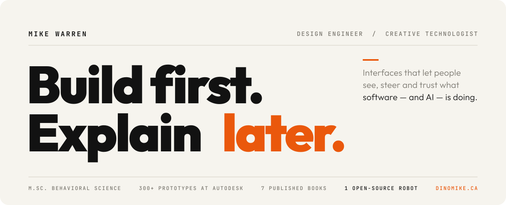</picture></a>

<a href="https://dinomike.ca"><picture><source media="(prefers-color-scheme: dark)" srcset="cards/00-maker-compound-dark.svg">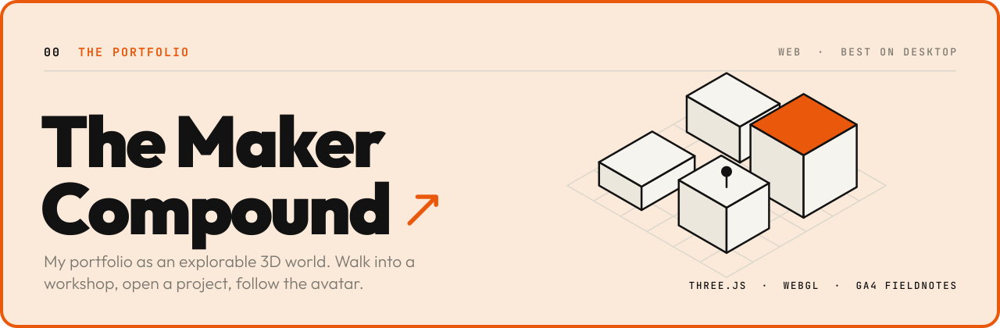</picture></a>

<a href="https://github.com/dinosaurmike/Shellfall"><picture><source media="(prefers-color-scheme: dark)" srcset="cards/11-shellfall-dark.svg"></picture></a>

<a href="https://github.com/dinosaurmike/Orbit"><picture><source media="(prefers-color-scheme: dark)" srcset="cards/07-orbit-dark.svg"></picture></a>

<a href="https://www.instructables.com/Brain-Turbocharger/"><picture><source media="(prefers-color-scheme: dark)" srcset="cards/10-brain-turbocharger-dark.svg">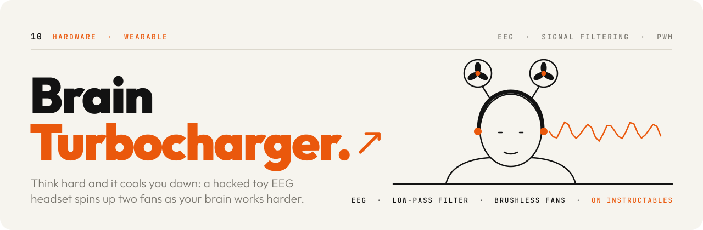</picture></a>

<a href="https://dinomike.ca/IdeaBox/"><picture><source media="(prefers-color-scheme: dark)" srcset="cards/01-ideabox-dark.svg">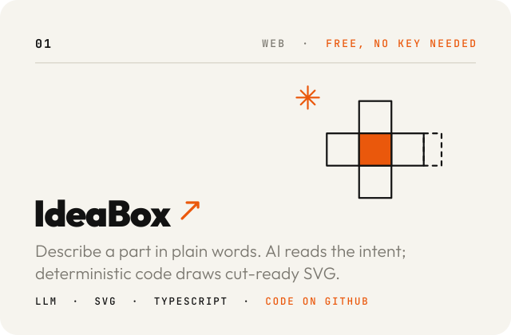</picture></a>
<a href="https://dinomike.ca/TimberCraft/"><picture><source media="(prefers-color-scheme: dark)" srcset="cards/02-timbercraft-dark.svg">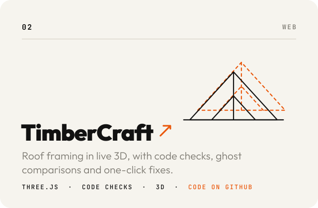</picture></a>

<a href="https://dinomike.ca/NoteToShelf/"><picture><source media="(prefers-color-scheme: dark)" srcset="cards/03-shelflife-dark.svg">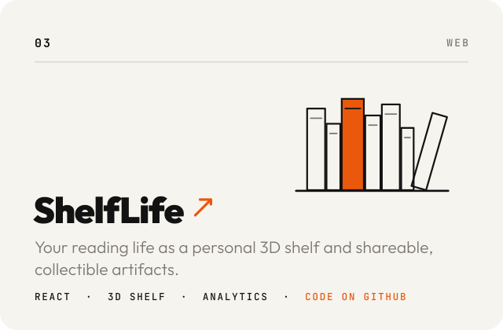</picture></a>
<a href="https://dinomike.ca/GarageStudio/"><picture><source media="(prefers-color-scheme: dark)" srcset="cards/04-ar-organizer-dark.svg"></picture></a>

<a href="https://dinomike.ca/ToyboxSiege/"><picture><source media="(prefers-color-scheme: dark)" srcset="cards/05-toybox-siege-dark.svg">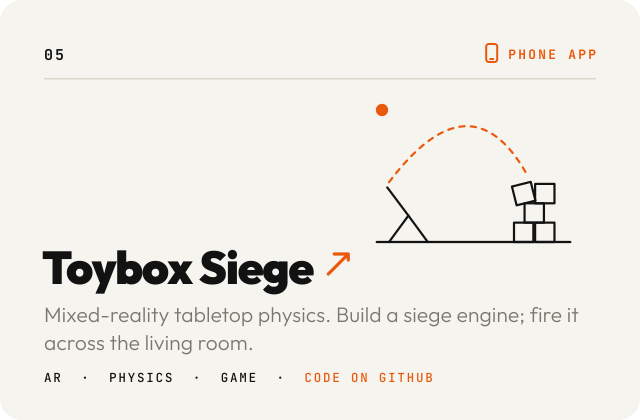</picture></a>
<a href="https://dinomike.ca/solar/"><picture><source media="(prefers-color-scheme: dark)" srcset="cards/06-solar-roi-dark.svg">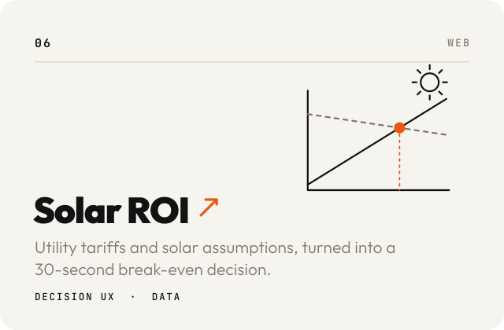</picture></a>

<a href="https://dinomike.ca/DayMark/"><picture><source media="(prefers-color-scheme: dark)" srcset="cards/08-daymark-dark.svg">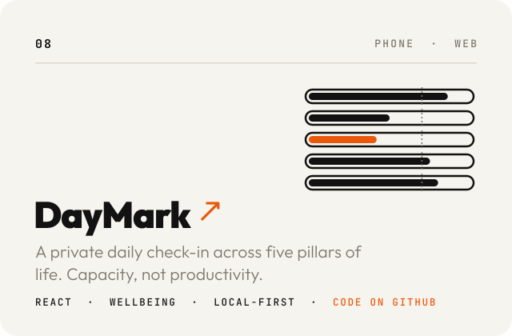</picture></a>
<a href="https://github.com/dinosaurmike/BayAreaRealEstateGames"><picture><source media="(prefers-color-scheme: dark)" srcset="cards/09-bay-area-games-dark.svg"></picture></a>

 

**Human–AI interaction.** &nbsp;Direct manipulation, ghost overlays, live verification and supervisory controls, not another chat box. 
**Legible state.** &nbsp;What the system is doing, what changed, and how sure it is. 
**Code-first.** &nbsp;React, TypeScript, Three.js, SVG and LLM APIs, with deterministic code where precision matters. 
**Open source.** &nbsp;[Shellfall](https://github.com/dinosaurmike/Shellfall) and [Orbit](https://github.com/dinosaurmike/Orbit) are MIT-licensed, from the 60 Hz falling-sand engine to the Android app and neck firmware. The code for [IdeaBox](https://github.com/dinosaurmike/IdeaBox), [ShelfLife](https://github.com/dinosaurmike/ShelfLife), [TimberCraft](https://github.com/dinosaurmike/TimberCraft), [Toybox Siege](https://github.com/dinosaurmike/ToyboxSiege), [Garage Studio](https://github.com/dinosaurmike/GarageStudio), [SolarBreak](https://github.com/dinosaurmike/SolarBreak), [DayMark](https://github.com/dinosaurmike/DayMark) and the [Bay Area Games](https://github.com/dinosaurmike/BayAreaRealEstateGames) is here to read. Built with Claude Code as a coding partner. 
**History.** &nbsp;Most of these were built over the last few years and have lived on [dinomike.ca](https://dinomike.ca); I moved them to GitHub in November 2026, so their commit history starts there.

Prefer a flat page? [Classic portfolio](https://dinomike.ca/classic.html) &nbsp;·&nbsp; [LINKEDIN](https://www.linkedin.com/in/mikewar/) &nbsp;·&nbsp; [INSTRUCTABLES](https://www.instructables.com/member/mikeasaurus/) &nbsp;·&nbsp; [YOUTUBE](https://www.youtube.com/MikeWarren)
