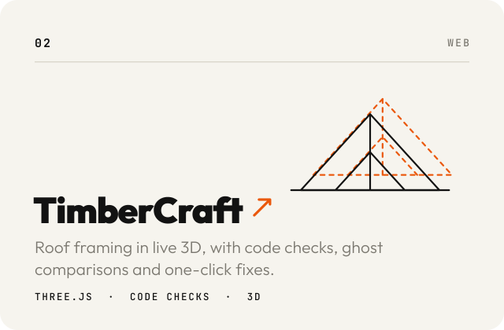
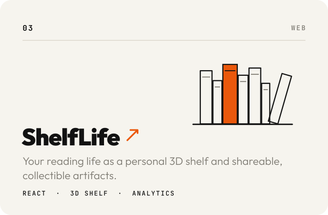
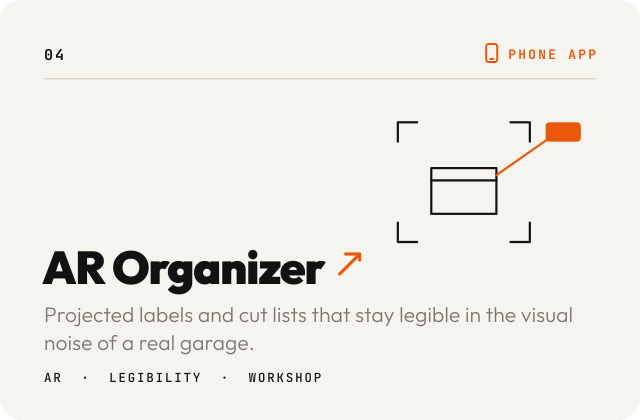
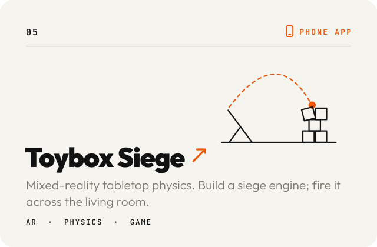
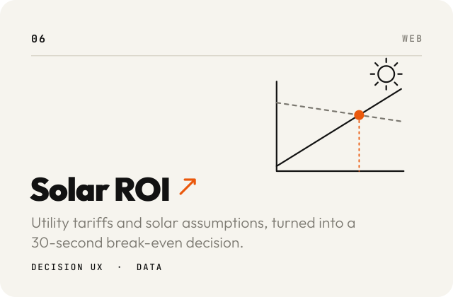

 

**Human–AI interaction.** &nbsp;Direct manipulation, ghost overlays, live verification and supervisory controls, not another chat box. 
**Legible state.** &nbsp;What the system is doing, what changed, and how sure it is. 
**Code-first.** &nbsp;React, TypeScript, Three.js, SVG and LLM APIs, with deterministic code where precision matters.

Prefer a flat page? [Classic portfolio](https://dinomike.ca/classic.html) &nbsp;·&nbsp; [LINKEDIN](https://www.linkedin.com/in/mikewar/) &nbsp;·&nbsp; [INSTRUCTABLES](https://www.instructables.com/member/mikeasaurus/) &nbsp;·&nbsp; [YOUTUBE](https://www.youtube.com/MikeWarren)
